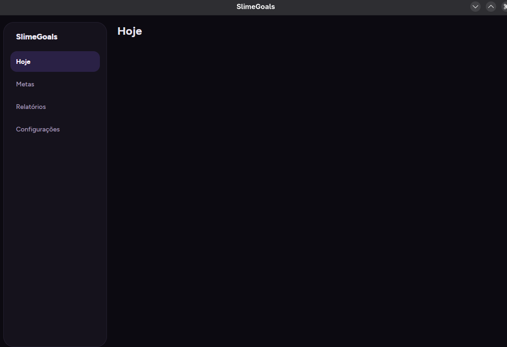

# SlimeGoals

Gestor de metas pessoais com lembretes, para **Linux (GNOME)** e, em seguida, **Android**.
Você cadastra tarefas únicas, hábitos diários ou metas semanais, recebe lembretes até cumpri-las,
registra o progresso com um check-in e acompanha relatórios semanais e mensais. Funciona offline,
com os dados guardados localmente em SQLite.



> **Status:** em desenvolvimento. Fases 0 (fundação) e 1 (domínio e persistência de metas) concluídas;
> as telas de metas são o próximo passo. Veja o [roteiro](#roteiro).

## Funcionalidades do MVP

- **Três tipos de meta:** única (um check-in conclui), diária (alvo por dia nos dias escolhidos) e semanal (alvo por semana, de segunda a domingo)
- **Lembretes** dentro de uma janela de horário, com as ações **Feito**, **Adiar** e **Ignorar** direto na notificação do sistema
- **Tela Hoje** com o progresso do período atual e check-in rápido
- **Relatórios** semanais e mensais, com sequências em dias ou semanas
- **Arquivamento** sem perda de histórico; tema escuro roxo

## Stack

| Camada | Tecnologia |
|---|---|
| Runtime | .NET 10 (LTS) |
| UI | Avalonia 12 + CommunityToolkit.Mvvm |
| Dados | SQLite (Microsoft.Data.Sqlite + Dapper), migrações por `PRAGMA user_version` |
| Testes | xUnit v3 (Microsoft Testing Platform) + AwesomeAssertions + `FakeTimeProvider` |

## Arquitetura

Hexagonal pragmática: o **Core** concentra domínio e regras e não depende de nada. Os demais
projetos implementam suas portas, e a composição (injeção de dependência) acontece só nos *heads*.

```
SlimeGoals.Desktop ─┐            (SlimeGoals.Android — Fase 7)
                    ▼
                SlimeGoals.App          Views + ViewModels Avalonia
                    │
                    ▼
                SlimeGoals.Core         domínio, serviços, interfaces
                    ▲
       ┌────────────┴─────────────┐
SlimeGoals.Infrastructure   SlimeGoals.Platform.Linux
(SQLite, repositórios)      (caminhos XDG; notificações e autostart nas próximas fases)
```

Um teste de arquitetura garante que o Core não referencia UI, banco ou plataforma.

```
src/
  SlimeGoals.Core/             Domain/, Services/, Validation/, Abstractions/
  SlimeGoals.Infrastructure/   Data/ (conexão, migrações SQL, repositórios)
  SlimeGoals.Platform.Linux/
  SlimeGoals.App/              Views/, ViewModels/, Styles/ (tokens do tema), Assets/Fonts/
  SlimeGoals.Desktop/          Program.cs, CompositionRoot.cs
tests/                         um projeto de teste por projeto de src/
specs/                         especificação, protótipos, planos e conclusões de spikes
```

## Como rodar

**Pré-requisito:** SDK do .NET 10 (`dotnet --version` ≥ 10.0.113; no Arch/CachyOS: `sudo pacman -S dotnet-sdk`).

```bash
git clone https://github.com/ALCM-bit/SlimeGoals.git
cd SlimeGoals

dotnet build SlimeGoals.slnx
dotnet test --solution SlimeGoals.slnx
dotnet run --project src/SlimeGoals.Desktop
```

Os dados ficam em `$XDG_DATA_HOME/SlimeGoals/slimegoals.db` (padrão: `~/.local/share/SlimeGoals/slimegoals.db`).
Para testar sem tocar nos seus dados, aponte para outra pasta:

```bash
XDG_DATA_HOME=/tmp/slimegoals-dev dotnet run --project src/SlimeGoals.Desktop
```

## Documentação

- [Especificação (v1.3)](specs/Planejamento_v3.md): requisitos, modelo de dados, regras de lembrete e design system
- [Protótipos visuais](specs/design/): desktop (`v4-bento-desktop.html`) e mobile (`v3-*-mobile.html`)
- [Planos de implementação](specs/plans/)

## Como contribuir

- **Feature Branch Workflow:** uma branch por funcionalidade (`feat/…`, `fix/…`, `docs/…`), integrada na `main` por Pull Request com *merge commit*
- **[Conventional Commits](https://www.conventionalcommits.org/pt-br/)** em português, com escopos por camada: `core`, `infra`, `app`, `linux`, `desktop`, `android`, `specs`, `plans`, `build`
- **TDD:** todo comportamento novo começa por um teste que falha; a `main` sempre compila sem warnings e passa nos testes

## Roteiro

| Fase | Entrega | Status |
|---|---|---|
| 0 | Fundação, tema, navegação e spikes (notificações GNOME, Android) | ✅ fundação · ⏳ spikes |
| 1 | Domínio e persistência de metas | ✅ |
| 2 | Telas de metas | ⏳ |
| 3 | Check-ins e tela Hoje | |
| 4 | Lembretes (planejador, agendador, notificação nativa, segundo plano) | |
| 5 | Relatórios | |
| 6 | Acabamento e empacotamento Linux | |
| 7 | Android | |
| 8 | Mascote slime (opcional) | |

## Licença

[PolyForm Noncommercial 1.0.0](LICENSE.md): uso **pessoal, educacional, de pesquisa e por organizações sem fins lucrativos** é permitido,
inclusive modificar e redistribuir com a licença. **Uso comercial não é permitido.**
Por restringir o uso comercial, este projeto é *source-available*, não *open source* no sentido da OSI.

Componentes de terceiros mantêm suas licenças: veja [THIRD-PARTY-NOTICES.md](THIRD-PARTY-NOTICES.md).
