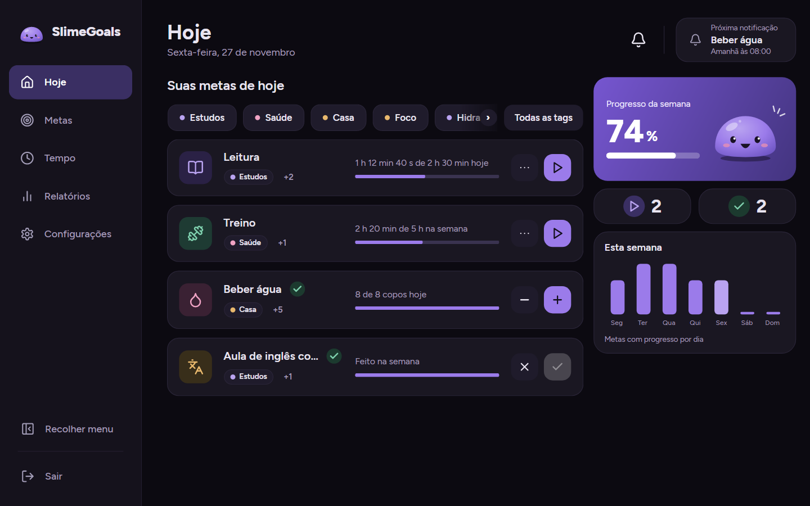

# SlimeGoals

Gestor de metas pessoais com lembretes, para **Linux (GNOME)** e **Android**.
Você cadastra hábitos diários ou metas semanais, recebe lembretes até cumpri-las,
registra o progresso com um check-in e acompanha relatórios semanais e mensais. Funciona offline,
com os dados guardados localmente em SQLite. A conta de sincronização é opcional: sem ela, os dados não saem do aparelho; com ela, saem cifrados.



> **Status:** em desenvolvimento, na versão 0.15.1. O app funciona no Linux, com pacote de instalação, e no Android, com APK assinado. O autor já testou num celular de verdade a instalação, as notificações e os lembretes, inclusive depois de religar o aparelho. A sincronização entre aparelhos, cifrada de ponta a ponta, já vem nos dois apps: o servidor fica numa VM sua, alcançável só pela sua tailnet. Veja o [roteiro](#roteiro).

## Funcionalidades

- **Dois tipos de meta:** diária (alvo por dia nos dias escolhidos) e semanal (alvo por semana, de segunda a domingo)
- **Três medidas por meta:** conclusão, quantidade ou tempo, com cronômetro e contagem em segundos
- **Lembretes** dentro de uma janela de horário, com a ação da medida (**Feito**, **+1** ou **Iniciar**), **Adiar** e **Ignorar** direto na notificação do sistema
- **Tela Hoje** com o progresso do período atual, registro rápido, a próxima notificação e o sino para pausar os lembretes
- **Tags** coloridas para organizar as metas e filtrar o Hoje, com várias tags por meta
- **Tarefas no cronômetro:** dê nome ao que está fazendo e troque de tarefa sem parar o tempo
- **Cronômetro à vista fora do app:** numa janela pequena por cima das outras no Linux e numa notificação fixa no Android, com o botão de parar
- **Pomodoro**, na aba Tempo: uma sequência de blocos de foco e de pausa, com os tempos que você quiser. O app avisa quando cada bloco acaba e espera um toque para começar o próximo; o foco pode contar numa meta de tempo
- **Slime** no Hoje, que muda de pose e de frase conforme o andamento do dia
- **Relatórios** semanais e mensais, com sequências em dias ou semanas
- **Arquivamento** sem perda de histórico; tema escuro roxo
- **Sincronização entre aparelhos**, cifrada de ponta a ponta: opcional, com servidor próprio ([como usar](docs/sincronizacao.md))

## Instalar

Ainda não há pacote pronto para baixar: os dois são gerados a partir do código.

- **Linux:** um `.tar.gz` que não precisa do .NET instalado e fica só no seu usuário. Veja [Instalar no Linux](docs/linux.md).
- **Android:** um APK assinado com a sua chave, para Android 8.0 ou mais novo. Veja [Instalar no celular](docs/android.md#instalar-no-celular).

## Começo rápido

**Pré-requisito:** SDK do .NET 10 (`dotnet --version` ≥ 10.0.113; no Arch/CachyOS: `sudo pacman -S dotnet-sdk`). Os testes do servidor precisam do Docker rodando.

```bash
git clone https://github.com/ALCM-bit/SlimeGoals.git
cd SlimeGoals

dotnet build SlimeGoals.slnx
dotnet test --solution SlimeGoals.slnx

# roda com dados e configuração de teste, sem tocar nos seus
XDG_DATA_HOME=/tmp/slimegoals-dev/data XDG_CONFIG_HOME=/tmp/slimegoals-dev/config \
  dotnet run --project src/SlimeGoals.Desktop
```

O app instalado guarda os dados em `~/.local/share/SlimeGoals/slimegoals.db`. Em desenvolvimento, use sempre outra pasta, como no comando acima. Os detalhes estão em [Desenvolvimento](docs/desenvolvimento.md).

## Documentação

| Guia | O que tem |
|---|---|
| [Desenvolvimento](docs/desenvolvimento.md) | Pré-requisitos, compilar e testar, testes que dependem de Docker e do chaveiro, conferir telas em PNG, CI, subir a versão, como contribuir |
| [Arquitetura](docs/arquitetura.md) | Projetos e dependências, pastas, regras que os testes garantem, sincronização e servidor |
| [Linux](docs/linux.md) | Gerar o pacote, instalar, atualizar e desinstalar |
| [Android](docs/android.md) | Emulador, permissões e comandos `adb`, gerar o APK assinado, instalar e atualizar no celular |
| [Servidor de sincronização](docs/servidor.md) | Segredos, desenvolvimento, publicação na tailnet (certificado, backup, firewall), atualização de um banco antigo, produção com HTTPS e SMTP |
| [Sincronização](docs/sincronizacao.md) | O que a cifra protege e como usar a conta no Linux e no Android |

As especificações ficam em [`specs/`](specs/):

- [Especificação geral (v1.4)](specs/Planejamento_v3.md): requisitos, modelo de dados, regras de lembrete e design system
- [Sincronização](specs/Sincronizacao_v1.md), [Endurecimento do servidor](specs/Endurecimento_do_servidor_v1.md), [Publicação na tailnet](specs/Publicacao_na_tailnet_v1.md) e [Segurança segundo a OWASP](specs/Seguranca_OWASP_v1.md)
- [Cronômetro fora do app](specs/Cronometro_fora_do_app_v1.md), [Tarefas no cronômetro](specs/Tarefas_no_cronometro_v1.md), [Pomodoro](specs/Pomodoro_v1.md), [Segundos nas metas de tempo](specs/Segundos_nas_metas_de_tempo_v1.md) e [Tags](specs/Tags_v1.md)
- [Protótipos visuais](specs/design/) (desktop em `v4-bento-desktop.html`, celular em `v3-*-mobile.html`; o Hoje do desktop agora segue as decisões 18 a 24 da especificação geral), [planos de implementação](specs/plans/) e [conclusões dos spikes](specs/spikes/)

## Stack

| Camada | Tecnologia |
|---|---|
| Runtime | .NET 10 (LTS) |
| UI | Avalonia 12 + CommunityToolkit.Mvvm, a mesma nos dois sistemas |
| Dados no aparelho | SQLite (Microsoft.Data.Sqlite + Dapper), migrações por `PRAGMA user_version` |
| Linux | D-Bus (Tmds.DBus.Protocol): notificações, chaveiro (Secret Service) e suspensão |
| Sincronização | AES-256-GCM e Argon2id (Konscious) no aparelho, HTTP + JSON |
| Servidor | ASP.NET Core + PostgreSQL 18 (Npgsql + Dapper), MailKit, Caddy e Docker Compose |
| Testes | xUnit v3 (Microsoft Testing Platform) + AwesomeAssertions + `FakeTimeProvider`; Testcontainers para o PostgreSQL |

A arquitetura é hexagonal pragmática: o **Core** concentra o domínio e as regras e não depende de nada, e a composição acontece só nos executáveis de cada sistema. Veja [Arquitetura](docs/arquitetura.md).

## Como contribuir

- **Feature Branch Workflow:** uma branch por mudança (`feat/…`, `fix/…`, `docs/…`), integrada na `main` por Pull Request com *merge commit*
- **[Conventional Commits](https://www.conventionalcommits.org/pt-br/)** em português, com escopo por camada
- **TDD:** todo comportamento novo começa por um teste que falha; a `main` sempre compila sem avisos e passa nos testes

Os detalhes estão em [Desenvolvimento](docs/desenvolvimento.md#como-contribuir).

## Roteiro

| Fase | Entrega | Status |
|---|---|---|
| 0 | Fundação, tema, navegação e spikes (notificações GNOME, Android) | ✅ |
| 1 | Domínio e persistência de metas | ✅ |
| 2 | Telas de metas | ✅ |
| 3 | Medidas, registros e tela Hoje | ✅ |
| 4 | Lembretes (planejador, agendador, notificação nativa, segundo plano) | ✅ |
| 5 | Relatórios | ✅ |
| 6 | Acabamento e empacotamento Linux | ✅ |
| 7 | Android (7a interface ✅ · 7b lembretes ✅ · 7c distribuição ✅ · teste longo com a tela bloqueada ✅) | ✅ |
| 8 | Mascote slime | ✅ |
| 9 | Sincronização cifrada (9.1 modelo local ✅ · 9.2 motor ✅ · 9.3 servidor ✅ · 9.4 criptografia e conta ✅ · 9.5a conta no Linux ✅ · 9.5b conta no Android ✅ · endurecimento do servidor ✅ · 9.6 publicação na tailnet ✅) | ✅ |

Fora das fases, já entregues: cronômetro fora do app, tarefas no cronômetro, Pomodoro e aba Tempo (0.9.0), segundos nas metas de tempo (0.10.0), tags (0.13.0) e o Hoje do desktop novo, com o menu lateral que recolhe (0.15.0).

## Licença

[PolyForm Noncommercial 1.0.0](LICENSE.md): uso **pessoal, educacional, de pesquisa e por organizações sem fins lucrativos** é permitido,
inclusive modificar e redistribuir com a licença. **Uso comercial não é permitido.**
Por restringir o uso comercial, este projeto é *source-available*, não *open source* no sentido da OSI.

Componentes de terceiros mantêm suas licenças: veja [THIRD-PARTY-NOTICES.md](THIRD-PARTY-NOTICES.md).
