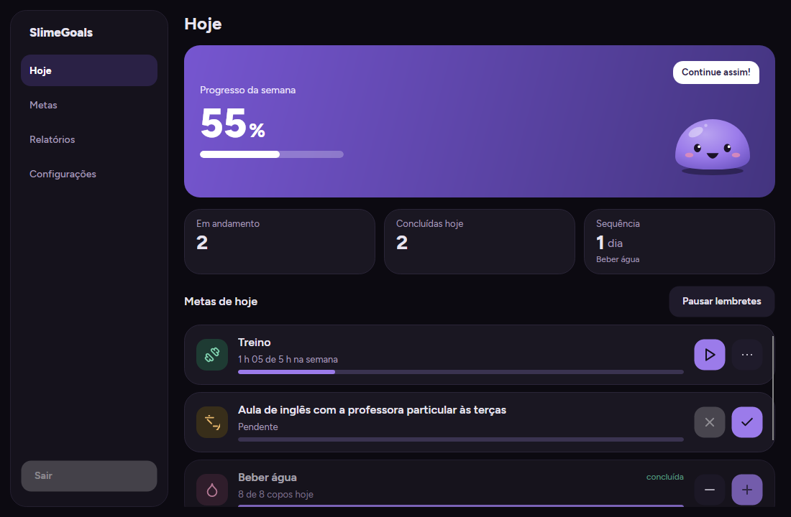

# SlimeGoals

Gestor de metas pessoais com lembretes, para **Linux (GNOME)** e **Android**.
Você cadastra hábitos diários ou metas semanais, recebe lembretes até cumpri-las,
registra o progresso com um check-in e acompanha relatórios semanais e mensais. Funciona offline,
com os dados guardados localmente em SQLite.



> **Status:** em desenvolvimento. O app funciona no Linux, com pacote de instalação, e no Android, onde já dá para
> gerar um APK assinado ([Instalar no Android](#instalar-no-android)). O autor já testou num celular de verdade a instalação, as notificações e os lembretes, inclusive depois de religar o aparelho. Veja o [roteiro](#roteiro).

## Funcionalidades do MVP

- **Dois tipos de meta:** diária (alvo por dia nos dias escolhidos) e semanal (alvo por semana, de segunda a domingo)
- **Três medidas por meta:** conclusão, quantidade ou tempo (com cronômetro)
- **Lembretes** dentro de uma janela de horário, com a ação da medida (**Feito**, **+1** ou **Iniciar**), **Adiar** e **Ignorar** direto na notificação do sistema
- **Tela Hoje** com o progresso do período atual e registro rápido
- **Slime** no Hoje, que muda de pose e de frase conforme o andamento do dia
- **Relatórios** semanais e mensais, com sequências em dias ou semanas
- **Arquivamento** sem perda de histórico; tema escuro roxo

## Stack

| Camada | Tecnologia |
|---|---|
| Runtime | .NET 10 (LTS) |
| UI | Avalonia 12 + CommunityToolkit.Mvvm |
| Dados | SQLite (Microsoft.Data.Sqlite + Dapper), migrações por `PRAGMA user_version` |
| Testes | xUnit v3 (Microsoft Testing Platform) + AwesomeAssertions + `FakeTimeProvider` |

## Arquitetura

Hexagonal pragmática: o **Core** concentra domínio e regras e não depende de nada. Os demais
projetos implementam suas portas, e a composição (injeção de dependência) acontece só nos *heads*.

```
SlimeGoals.Desktop   SlimeGoals.Android
         └─────────┬─────────┘
                   ▼
            SlimeGoals.App          Views + ViewModels Avalonia
                   │
                   ▼
            SlimeGoals.Core         domínio, serviços, interfaces
                   ▲
       ┌───────────┴──────────────┐
SlimeGoals.Infrastructure   SlimeGoals.Platform.Linux
(SQLite, repositórios)      (caminhos XDG, notificações D-Bus, agendador,
                             autostart, instância única)
```

O head Android implementa as portas de lembretes direto no projeto (`AlarmManager`, notificações, permissões).
Um teste de arquitetura garante que o Core não referencia UI, banco ou plataforma.

```
src/
  SlimeGoals.Core/             Domain/, Services/, Validation/, Abstractions/
  SlimeGoals.Infrastructure/   Data/ (conexão, migrações SQL, repositórios)
  SlimeGoals.Platform.Linux/   Notifications/, Scheduling/, Autostart/, Power/, SingleInstance/
  SlimeGoals.App/              Views/, ViewModels/, Styles/ (tokens do tema), Assets/Fonts/
  SlimeGoals.Desktop/          Program.cs, CompositionRoot.cs
  SlimeGoals.Android/          MainActivity, AndroidCompositionRoot, Reminders/
tests/                         testes do Core, Infrastructure, App e Platform.Linux; SlimeGoals.Testing (falsos)
tools/SlimeGoals.Render/       grava PNGs das telas sem abrir o app
packaging/linux/               pacote .tar.gz e instalador
packaging/android/             APK assinado (build.sh) e criação da chave (make-keystore.sh)
src/SlimeGoals.Server/         servidor de sincronização (ASP.NET Core + PostgreSQL), fora do app
src/SlimeGoals.Sync/           motor de sincronização; SlimeGoals.Sync.Contracts: contratos do protocolo
specs/                         especificação, protótipos, planos e conclusões de spikes
```

## Como rodar

**Pré-requisito:** SDK do .NET 10 (`dotnet --version` ≥ 10.0.113; no Arch/CachyOS: `sudo pacman -S dotnet-sdk`).

```bash
git clone https://github.com/ALCM-bit/SlimeGoals.git
cd SlimeGoals

dotnet build SlimeGoals.slnx
dotnet test --solution SlimeGoals.slnx
dotnet run --project src/SlimeGoals.Desktop
```

Os dados ficam em `$XDG_DATA_HOME/SlimeGoals/slimegoals.db` (padrão: `~/.local/share/SlimeGoals/slimegoals.db`).
Para testar sem tocar nos seus dados, aponte para outra pasta:

```bash
XDG_DATA_HOME=/tmp/slimegoals-dev dotnet run --project src/SlimeGoals.Desktop
```

## Rodar no Android (desenvolvimento)

O head Android fica fora de `SlimeGoals.slnx` (o `dotnet test` do dia a dia não exige o workload `android`); ele entra em `SlimeGoals.Android.slnx`.

**Pré-requisitos** (os do spike): workload `android` do .NET, JDK 21, Android SDK em `~/Android/Sdk` e o AVD `slimegoals-api36`.

```bash
# compilar
dotnet build SlimeGoals.Android.slnx -p:AndroidSdkDirectory=$HOME/Android/Sdk -p:JavaSdkDirectory=/usr/lib/jvm/java-21-openjdk

# iniciar o emulador (em outro terminal)
~/Android/Sdk/emulator/emulator -avd slimegoals-api36

# instalar o APK Debug no emulador
dotnet build src/SlimeGoals.Android -t:Install -f net10.0-android -p:AndroidSdkDirectory=$HOME/Android/Sdk -p:JavaSdkDirectory=/usr/lib/jvm/java-21-openjdk

# abrir o app (ou toque no ícone do slime)
~/Android/Sdk/platform-tools/adb shell monkey -p dev.alcm.slimegoals 1
```

Os dados ficam no armazenamento privado do app (`<FilesDir>/slimegoals.db`); desinstalar o app apaga tudo. O app não entra no backup do Android nem na transferência entre aparelhos: as metas ficam só neste celular.

**Lembretes:** o app precisa de duas permissões, que o Android 16 traz negadas num app recém-instalado: notificações e alarmes exatos. O aviso na tela Hoje oferece "Permitir" para as duas (Configurações mostra o estado de cada uma). Sem alarmes exatos os lembretes seguem, mas podem atrasar alguns minutos.

Comandos `adb` úteis (`adb` em `~/Android/Sdk/platform-tools`):

```bash
# notificações
adb shell pm grant dev.alcm.slimegoals android.permission.POST_NOTIFICATIONS

# alarmes exatos (use --uid; a forma por pacote não tem efeito na API 36)
adb shell appops set --uid dev.alcm.slimegoals SCHEDULE_EXACT_ALARM allow   # ou deny

# alarme armado
adb shell dumpsys alarm | grep -A3 slimegoals

# encerrar o processo como o sistema faz (o alarme continua; force-stop o cancela)
adb shell am kill dev.alcm.slimegoals
```

Para conferir os layouts sem emulador, `dotnet run --project tools/SlimeGoals.Render -- /tmp/render [phone|desktop|all]` grava PNGs de cada página em 412×915 (celular) e 1100×720 (desktop).

## Servidor de sincronização (desenvolvimento)

O servidor da fase 9 (`src/SlimeGoals.Server`, ASP.NET Core + PostgreSQL) ainda não é usado pelo app; esta etapa só o deixa rodando e testado. Pré-requisito: Docker com o plugin Compose.

```bash
cp .env.example .env
# preencha POSTGRES_PASSWORD e SERVER_PRELOGIN_SECRET (ex.: openssl rand -base64 32)
docker compose up -d --build --wait
curl -fsS http://127.0.0.1:8080/health
```

- A API responde em `http://127.0.0.1:8080`, publicada só no seu computador. O PostgreSQL não tem porta publicada.
- O servidor sobe em `Development`, com o e-mail simulado: o token de confirmação do cadastro aparece no log (`docker compose logs server`).
- O `.env` fica fora do repositório. Sem as duas variáveis, o `docker compose` recusa subir.
- Os dados ficam no volume `slimegoals_pgdata`. `docker compose down` mantém o volume; `docker compose down -v` apaga o banco.
- As rotas, os limites e os códigos de erro estão em [specs/Sincronizacao_v1.md](specs/Sincronizacao_v1.md), seção 5.

**Os testes do servidor usam Docker.** Os testes de integração sobem um PostgreSQL de verdade com Testcontainers, então `dotnet test --solution SlimeGoals.slnx` agora precisa do Docker rodando. Se o Testcontainers falhar ao subir o contêiner auxiliar (ryuk), por exemplo por uma credencial antiga do Docker, baixe as imagens à mão e rode de novo:

```bash
docker pull postgres:18-alpine
docker pull testcontainers/ryuk:0.14.0   # use a versão que o erro indicar
```

## Instalar no Android

O APK é assinado com uma chave sua, que fica fora do repositório. Ele traz as arquiteturas arm64 (celulares) e x64 (emulador) e exige Android 8.0 ou mais novo (API 26). Pré-requisitos: os de [Rodar no Android](#rodar-no-android-desenvolvimento).

1. **Crie a chave uma vez** e guarde uma cópia dela num lugar seguro:

   ```bash
   packaging/android/make-keystore.sh
   ```

   O script pede uma senha e grava a chave em `~/.android-keystores/slimegoals.keystore` (ou onde `SLIMEGOALS_KEYSTORE` apontar); ele não sobrescreve uma chave que já existe. **Perder a chave, ou a senha, impede atualizar o app instalado.**

2. **Gere o APK:**

   ```bash
   packaging/android/build.sh
   ```

   O script pede a senha da chave (ela não fica no histórico do shell). Para uma chave em outro lugar, aponte `SLIMEGOALS_KEYSTORE`; sem terminal (CI, por exemplo), defina `SLIMEGOALS_KEYSTORE_PASS`. O SDK do Android e o JDK vêm de `ANDROID_HOME` e `JAVA_HOME`, com padrão `~/Android/Sdk` e `/usr/lib/jvm/java-21-openjdk`.

   O resultado é `artifacts/slimegoals-0.7.0-android.apk`.

3. **Instale no celular:** com a depuração USB ligada, `adb install artifacts/slimegoals-0.7.0-android.apk`; ou copie o APK para o aparelho e abra-o, permitindo "instalar apps desconhecidos" para o app que o abriu.

4. **Primeira abertura:** no aviso do Hoje, toque em "Permitir" (notificações e alarmes exatos). Depois, em Configurações → Bateria, toque em "Liberar" e aceite: sem isso o sistema pode adiar ou suspender os lembretes com o celular parado. Liberar a bateria faz "Alarmes exatos" aparecer como permitido, porque o Android trata assim os apps sem restrição de bateria; se você tirar o app dessa isenção, o bloqueio volta.

5. **No Samsung (One UI)**, confira também:
   - Configurações → Aplicativos → SlimeGoals → Bateria → "Sem restrições";
   - Configurações → Bateria → Limites de uso em segundo plano: o app não pode estar em "Apps em suspensão" nem em "Apps em suspensão profunda".

6. **Atualizar:** gere o APK de novo com o mesmo comando e instale com `adb install -r artifacts/slimegoals-<versão>-android.apk`, mantendo os dados. **Com outra chave, só desinstalando o app, o que apaga os dados.**

## Instalar no Linux

O pacote é um `.tar.gz` *self-contained* (não precisa do .NET instalado) para linux-x64. A instalação é só no seu usuário, sem root.

```bash
# gerar o pacote
bash packaging/linux/build.sh
tar -xzf artifacts/slimegoals-0.7.0-linux-x64.tar.gz
cd slimegoals-0.7.0
./install.sh
```

Ainda não há pacote pronto para baixar, então gere-o com o `build.sh`, que precisa do SDK do .NET. O `install.sh` só funciona de dentro da pasta extraída: rodar o de `packaging/linux/` dá erro, porque o app compilado não está ali.

Isso instala o app em `~/.local/opt/slimegoals/`, o link em `~/.local/bin/slimegoals`, o atalho em `~/.local/share/applications/slimegoals.desktop` e os ícones em `~/.local/share/icons/hicolor/`. Rodar `./install.sh` de novo substitui a versão instalada.

Para desinstalar, rode `./uninstall.sh` de dentro da pasta extraída. Ele pergunta se deve apagar também seus dados (a pasta `~/.local/share/SlimeGoals`, com o banco); a resposta padrão é não. Para apagar sem a pergunta, use `./uninstall.sh --apagar-dados` com o app fechado. Apagar os dados não tem volta. A entrada de "iniciar com o sistema" (`~/.config/autostart/slimegoals.desktop`) fica; apague-a à mão se quiser.

## Documentação

- [Especificação (v1.4)](specs/Planejamento_v3.md): requisitos, modelo de dados, regras de lembrete e design system
- [Protótipos visuais](specs/design/): desktop (`v4-bento-desktop.html`) e mobile (`v3-*-mobile.html`)
- [Planos de implementação](specs/plans/)

## Como contribuir

- **Feature Branch Workflow:** uma branch por funcionalidade (`feat/…`, `fix/…`, `docs/…`), integrada na `main` por Pull Request com *merge commit*
- **[Conventional Commits](https://www.conventionalcommits.org/pt-br/)** em português, com escopos por camada: `core`, `infra`, `app`, `linux`, `desktop`, `android`, `specs`, `plans`, `build`
- **TDD:** todo comportamento novo começa por um teste que falha; a `main` sempre compila sem warnings e passa nos testes

## Roteiro

| Fase | Entrega | Status |
|---|---|---|
| 0 | Fundação, tema, navegação e spikes (notificações GNOME, Android) | ✅ |
| 1 | Domínio e persistência de metas | ✅ |
| 2 | Telas de metas | ✅ |
| 3 | Medidas, registros e tela Hoje | ✅ |
| 4 | Lembretes (planejador, agendador, notificação nativa, segundo plano) | ✅ |
| 5 | Relatórios | ✅ |
| 6 | Acabamento e empacotamento Linux | ✅ |
| 7 | Android (7a interface ✅ · 7b lembretes ✅ · 7c distribuição ✅ implementado · ⏳ teste longo no aparelho) | ⏳ |
| 8 | Mascote slime | ✅ |

## Licença

[PolyForm Noncommercial 1.0.0](LICENSE.md): uso **pessoal, educacional, de pesquisa e por organizações sem fins lucrativos** é permitido,
inclusive modificar e redistribuir com a licença. **Uso comercial não é permitido.**
Por restringir o uso comercial, este projeto é *source-available*, não *open source* no sentido da OSI.

Componentes de terceiros mantêm suas licenças: veja [THIRD-PARTY-NOTICES.md](THIRD-PARTY-NOTICES.md).
