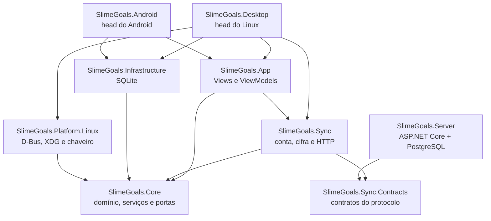

# Arquitetura

O app segue uma arquitetura hexagonal pragmática. O **Core** concentra o domínio, as regras e as **portas** (interfaces), e não depende de nada: nem de UI, nem de banco, nem de plataforma. Os outros projetos implementam as portas: são os **adaptadores**. A composição (injeção de dependência) acontece só nos *heads*, os executáveis de cada sistema.

"Pragmática" quer dizer que o App usa os serviços concretos do Core, sem uma interface para cada um. As interfaces ficam onde há mais de uma implementação ou onde o teste precisa de um dublê: o relógio, o banco, as notificações, o agendador, o cofre e a rede.

## Projetos e dependências



Os dois *heads* também referenciam o Core direto; as setas foram omitidas para o desenho ficar legível.

| Projeto | Papel | Referencia |
|---|---|---|
| `SlimeGoals.Core` | Domínio, serviços (os casos de uso), portas e o motor de sincronização | nada |
| `SlimeGoals.Infrastructure` | Adaptador SQLite: conexão, migrações, repositórios, estado e fila local da sincronização | Core |
| `SlimeGoals.Platform.Linux` | Adaptadores do Linux: notificações e suspensão por D-Bus, agendador, autostart XDG, instância única e chaveiro (Secret Service) | Core |
| `SlimeGoals.Sync` | O lado do aparelho na sincronização: coordenador, conta, cifra (AES-GCM e Argon2id) e transporte HTTP | Core, Sync.Contracts |
| `SlimeGoals.Sync.Contracts` | Contratos do protocolo e regras de e-mail, compartilhados pelo app e pelo servidor | nada |
| `SlimeGoals.App` | Views, ViewModels, estilos e a hospedagem da UI, comuns aos dois sistemas | Core, Sync |
| `SlimeGoals.Desktop` | Head do Linux: `Program.cs` e a raiz de composição | App, Core, Infrastructure, Platform.Linux, Sync |
| `SlimeGoals.Android` | Head do Android: atividade, raiz de composição e os adaptadores do Android (alarmes, notificações, Keystore) | App, Core, Infrastructure |
| `SlimeGoals.Server` | Servidor de sincronização, que roda fora do app | Sync.Contracts |

## Pastas

```
src/
  SlimeGoals.Core/
    Domain/                 metas, medidas, períodos, registros, cronômetro e sessão de foco
    Services/               casos de uso: GoalService, CheckinService, TimerService, FocusService, ReminderService…
    Validation/             validação do rascunho de meta
    Abstractions/           portas: repositórios, notificações, agendador, relógio, cofre…
    Sync/                   motor de sincronização, merge, agendamento e as portas dele
    Diagnostics/            texto de rastreio sem dado pessoal
  SlimeGoals.Infrastructure/
    Data/                   conexão, migrações SQL e repositórios
  SlimeGoals.Platform.Linux/
    Notifications/  Scheduling/  Autostart/  Power/  SingleInstance/  Secrets/
  SlimeGoals.Sync/
    Account/                cadastro, entrada, sessão e a API de conta
    Crypto/                 cifra dos registros, derivação de chaves e código de recuperação
    Vault/                  formato do segredo guardado no cofre
    SyncCoordinator.cs      ponto único das operações de conta e do ciclo do motor
  SlimeGoals.Sync.Contracts/
  SlimeGoals.App/
    Views/  ViewModels/  Styles/ (tokens do tema)  Assets/  Converters/
    Account/                a seção de conta: ViewModel, textos e endereço do servidor
    Goals/                  formatação de metas, relatórios e lembretes
    Hosting/                ciclo de vida, navegação, lembretes e janelinha do cronômetro
    About/  Licenses/       tela Sobre e os textos de licença embutidos
  SlimeGoals.Desktop/       Program.cs, CompositionRoot.cs, SleepResumeHost.cs
  SlimeGoals.Android/       MainActivity, AndroidCompositionRoot, Reminders/, Sync/, Resources/
  SlimeGoals.Server/
    Accounts/  Auth/  Limits/  Sync/  Data/
tests/                      um projeto de teste por projeto de src; SlimeGoals.Testing com os dublês compartilhados
tools/SlimeGoals.Render/    grava PNGs das telas sem abrir o app
packaging/linux/            pacote .tar.gz, install.sh e uninstall.sh
packaging/android/          APK assinado (build.sh) e criação da chave (make-keystore.sh)
packaging/server/           init-env.sh, upgrade-roles.sh, Caddyfile e os papéis do PostgreSQL
specs/                      especificações, protótipos, planos e conclusões dos spikes
docs/                       estes guias e as imagens do README
```

## Regras

- **O Core não referencia nada.** Nem projeto do repositório, nem Avalonia, Dapper, SQLite ou D-Bus. O teste `tests/SlimeGoals.Core.Tests/ArchitectureTests.cs` reprova quem quebrar a regra.
- **A composição fica nos heads.** `src/SlimeGoals.Desktop/CompositionRoot.cs` e `src/SlimeGoals.Android/AndroidCompositionRoot.cs` registram tudo e montam o contêiner com `ValidateOnBuild`: um serviço sem registro quebra na partida, não no primeiro uso. A Infrastructure oferece `AddSlimeGoalsInfrastructure`, que os dois heads chamam.
- **Uma View por ViewModel, sem reflexão.** O `App.axaml` liga cada ViewModel à sua View por `DataTemplate`, com bindings compilados. Não há *ViewLocator* por nome.
- **O Android implementa as próprias portas no head.** Alarmes (`AlarmManager`), notificações, permissões e o cofre no Android Keystore ficam em `src/SlimeGoals.Android`, porque só compilam com o workload `android`.
- **A conta vale em todos os builds.** O Release tem a seção de conta, o cofre e a rede (`https://` só). A propriedade `SyncDev`, ligada no Debug ou com `-p:SyncDev=true`, só liga os extras de desenvolvimento: servidor padrão `http://127.0.0.1:8080`, texto puro para o loopback no Android e o `CryptoSelfCheckReceiver` (veja [Sincronização](sincronizacao.md)).
- **O servidor só conhece os contratos.** Ele referencia só o `Sync.Contracts`, não o Core nem o Sync. Os registros chegam cifrados, e ele não tem como lê-los.

## Sincronização

O motor (`Core/Sync/SyncEngine.cs`) envia a fila local e aplica as páginas que o servidor devolve. Ele não sabe nada de HTTP nem de cifra, e fala com o mundo por quatro portas:

| Porta | Adaptador |
|---|---|
| `ISyncLocalStore` (fila e registros locais) | `Infrastructure/Data/SyncLocalStore.cs` |
| `ISyncTransport` (envio e recebimento) | `Sync/HttpSyncTransport.cs` |
| `ISyncCrypto` (cifra de cada registro) | `Sync/Crypto/AesGcmSyncCrypto.cs` |
| `ISecretVault` (sessão guardada no aparelho) | `Platform.Linux/Secrets/SecretServiceVault.cs` e `Android/Sync/AndroidKeystoreVault.cs` |

O `SyncCoordinator` liga o motor à conta e roda as operações de conta uma de cada vez: entrar, sair, trocar a senha e as outras nunca correm juntas, e só elas ligam, trocam ou param o motor. O App fala com ele pela interface `ISyncAccount`.

O desenho completo, com o protocolo, o merge e as decisões de cada fase, está em [specs/Sincronizacao_v1.md](../specs/Sincronizacao_v1.md).

## Servidor

O `SlimeGoals.Server` é organizado por assunto, em fatias verticais, sem as camadas do app: as rotas falam direto com as classes de SQL. Para um serviço pequeno, com um único tipo de cliente e testado de ponta a ponta contra um PostgreSQL de verdade, isso dá menos peças sem perder cobertura.

| Pasta | O que tem |
|---|---|
| `Accounts/` | rotas de conta (cadastro, confirmação, entrada, recuperação, aparelhos) e o envio do e-mail de confirmação |
| `Auth/` | o token do aparelho em cada requisição |
| `Limits/` | limites de taxa, limite do corpo e o IP do cliente |
| `Sync/` | rotas de envio e recebimento, limpeza dos registros antigos e manutenção periódica |
| `Data/` | conexão, migrações e a conferência dos papéis do banco |

Como subir e operar o servidor: [Servidor de sincronização](servidor.md). As decisões de segurança: [specs/Endurecimento_do_servidor_v1.md](../specs/Endurecimento_do_servidor_v1.md).
