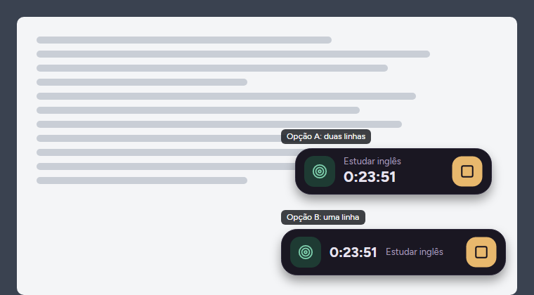

# Cronômetro visível fora do app (v1)

> Desenho aprovado pelo autor em 14/11/2026, com as cinco escolhas da seção 7 e a opção A da janelinha. O plano fica em `specs/plans/`.

## 1. Para que serve

Hoje, com um cronômetro de meta de tempo rodando, fechar ou minimizar o app esconde o tempo. A pessoa só sabe quanto passou, ou para o cronômetro, reabrindo o app. Com isso é fácil esquecer um cronômetro ligado.

Este desenho mantém o tempo à vista enquanto o app está fora da tela:

- **Linux:** uma janela pequena, sempre por cima das outras.
- **Android:** uma notificação fixa com o tempo correndo.

## 2. O que a pessoa vê

### 2.1 Linux: a janelinha

```
┌──────────────────────────────┐
│ ◉  Estudar inglês         ■  │
│    0:23:51                   │
└──────────────────────────────┘
```

O desenho acima é só a disposição. A aparência, com os estilos do app, está em `specs/design/cronometro-janelinha-prototipo.png`, em duas opções. **O autor escolheu a opção A em 14/11/2026:** o nome da meta em cima, menor, e o tempo embaixo, em destaque, com cerca de 280 px de largura.



- Mostra o ícone e o nome da meta, o tempo correndo (segundo a segundo) e um botão de parar.
- **Aparece** quando há cronômetro rodando e a janela principal some: fechada (escondida na bandeja) ou minimizada.
- **Some** quando a janela principal volta, ou quando o cronômetro para.
- **Clicar** nela abre a janela principal. **Arrastar** muda de lugar; a posição fica gravada.
- **Parar (■)** congela o cronômetro e abre a janela principal em Hoje, onde já existe o passo de conferir os minutos e registrar.
- **Esconder (×)**: um botão redondo sobre a borda da janelinha, no canto de cima à direita, que só aparece com o mouse sobre ela e acende com o mouse em cima dele. Esconde a janelinha até o próximo cronômetro, sem mudar a opção de Configurações. Pedido do autor em 14 e 15/11/2026.
- Não rouba o foco ao aparecer, não entra na barra de tarefas e não tem borda nem botões de janela.
- Posição inicial: canto inferior direito da tela principal.
- Uma opção em Configurações › Janela, "Mostrar o cronômetro numa janela pequena", ligada por padrão.

### 2.2 Android: a notificação

```
SlimeGoals · cronômetro
Estudar inglês                       0:23:51
[ Parar ]
```

- Notificação fixa, silenciosa, com o cronômetro do próprio sistema em letras grandes no corpo (ver a seção 9). Aparece na barra de status e na tela de bloqueio.
- **Aparece** quando um cronômetro começa (pelo app ou pelo "Iniciar" de um lembrete) e fica enquanto ele roda, mesmo com o app aberto.
- **Some** quando o cronômetro para, é registrado ou descartado.
- **Tocar** abre o app. **Parar** congela o cronômetro e abre o app em Hoje, para registrar.
- Canal próprio, "Cronômetro", de importância baixa: a pessoa pode desligá-lo nas configurações do Android sem perder os lembretes.

## 3. Objetivos e limites

**Objetivos**
- O tempo de um cronômetro rodando fica visível sem abrir o app, nas duas plataformas.
- Parar o cronômetro leva um toque ou um clique.

**Fora deste desenho**
- Iniciar um cronômetro, trocar de meta ou registrar minutos pela janelinha ou pela notificação. Isso continua no app.
- Pausar e retomar: o cronômetro do app não tem pausa.
- Janela flutuante ou picture-in-picture no Android.

**O que tornaria isto um fracasso**
- A janelinha roubar o foco do que a pessoa está digitando.
- A notificação fazer som ou vibrar.
- Qualquer serviço rodando o tempo todo no Android só para manter a notificação.
- O app Release do Linux ganhar qualquer comportamento novo com o cronômetro parado.

## 4. Restrições

- **Linux:** o app roda pelo X11 (XWayland no GNOME). "Sempre por cima", "sem foco ao aparecer" e posição livre dependem do gerenciador de janelas. Testado na máquina do autor em 14/11/2026 (seção 9).
- **Fechar encerra o app:** se a opção "Ao fechar a janela" for "encerrar", não há processo para mostrar a janelinha. O cronômetro continua valendo, porque só o instante de início fica gravado.
- **Android:** a notificação fixa pode ser dispensada pela pessoa (Android 14+). Ela volta quando o app abre de novo com o cronômetro rodando.
- **Reinício do celular:** notificações somem. O receptor de eventos do sistema, que já reagenda os lembretes no boot, repõe a notificação se houver cronômetro rodando.
- **Segurança e privacidade:** o nome da meta aparece na janelinha e na notificação, como já aparece nos lembretes. No Android, a tela de bloqueio segue a configuração do aparelho para conteúdo sensível.

## 5. Caminhos considerados

| Caminho | Prós | Contras |
|---|---|---|
| **Linux: janela pequena sempre por cima** (escolhido) | Sempre visível; um clique para parar | Depende do gerenciador de janelas; precisa de teste no GNOME |
| Linux: só o tempo no menu da bandeja | Nenhum risco de janela | Só aparece ao abrir o menu; não resolve "esqueci ligado" |
| **Android: notificação com cronômetro** (escolhido) | Nativo, sem permissão nova e sem serviço: o sistema desenha o tempo | Pode ser dispensada |
| Android: picture-in-picture | Parece uma janelinha | Feito para vídeo; exige tela compacta própria |
| Android: janela flutuante | Fica por cima de tudo | Permissão especial e um serviço sempre ligado |

O autor escolheu a janela no Linux e a notificação no Android em 13/11/2026.

## 6. Como se encaixa no código

**Núcleo comum (Core/App)**
- `TimerService` já avisa pelo `DataChangeNotifier` quando o cronômetro começa, para ou é limpo, e `ActiveTimer` guarda o instante de início. Nada muda no modelo nem no banco.
- Um componente novo, `RunningTimerWatcher`, escuta essas mudanças e publica "há um cronômetro rodando: meta X, desde T" ou "não há". As duas plataformas consomem isso.

**Linux**
- `MiniTimerWindow` e `MiniTimerViewModel` no projeto App, ao lado da `MainWindow`.
- Quem decide mostrar ou esconder é a `App`, que já controla a janela principal: mostra quando o watcher diz "rodando" e a principal está escondida ou minimizada.
- `PlatformCapabilities` ganha `MiniTimer` (verdadeiro só no desktop). `AppSettings` ganha a opção de mostrar e a posição gravada.
- Parar chama `TimerService.StopAsync` e depois `IWindowActivator.Activate`.

**Android**
- `AndroidTimerNotification`, ao lado do serviço de notificações dos lembretes: cria o canal "Cronômetro", publica a notificação com um layout próprio (um `Chronometer` no corpo) e a retira.
- O "Parar" não passa por um receptor: desde o Android 12, um receptor não pode abrir uma atividade a partir de uma notificação. O botão abre a `MainActivity` direto, por um `PendingIntent` de atividade com o extra `stopTimer`, e é ela que para o cronômetro e mostra Hoje. Tocar no corpo abre a mesma atividade sem o extra.
- A `MainActivity` é exportada (o launcher a abre), então qualquer app poderia mandar o mesmo extra. Desde 15/11/2026 o extra leva um código aleatório de 256 bits, criado uma vez por instalação e guardado nas preferências privadas do app, fora do banco que sincroniza (`StopRequestSecret`, `StopTimerSecretStore`). Sem o código certo, o pedido é ignorado e o app só abre. Um app com acesso às notificações, concedido pela pessoa, ainda consegue tocar o próprio botão: isso vale para qualquer notificação.
- O `SystemEventReceiver` repõe a notificação no boot.

**Testes**
- `RunningTimerWatcher` e `MiniTimerViewModel`: testes de unidade com relógio falso.
- A regra de mostrar e esconder: teste sobre uma abstração da janela, sem abrir janela de verdade.
- Aparência da janelinha: imagens na Render.
- Android: o que é lógica (quando publicar, quando retirar) fica testável fora do aparelho; o resto é conferido no celular.

## 7. Decisões do assistente, para o autor conferir

O autor escolheu os dois caminhos, mas não disse o que quer fazer pela janelinha. Estas escolhas são minhas:

1. A janelinha e a notificação mostram o tempo e têm **um botão de parar**, mais nada.
2. **Parar abre o app** para registrar os minutos, porque o app já pede essa conferência depois de parar.
3. A janelinha tem uma opção para desligar, **ligada por padrão**.
4. A notificação do Android fica visível **também com o app aberto**, como fazem os cronômetros do sistema.
5. Com "fechar encerra o app", **nada aparece** no Linux.

## 8. Ordem do trabalho

1. **Teste descartável no Linux** (meia hora): uma janela pequena, sem borda, por cima, sem foco, numa posição escolhida. O autor confere no GNOME. Se "sempre por cima" não funcionar, o desenho do Linux volta para discussão antes de qualquer código definitivo.
2. Núcleo comum e janelinha do Linux.
3. Notificação do Android, junto com o APK novo que já está pendente.

## 9. Como ficou

Implementado em 14/11/2026 (plano `specs/plans/2026-11-14-cronometro-fora-do-app.md`).

- **Spike no GNOME:** a janelinha ficou por cima, não tomou o foco, apareceu na posição pedida, arrastou e manteve os cantos arredondados, sem aviso de "janela pronta" (`specs/spikes/janelinha-cronometro.md`).
- **Notificação fora da tela:** `TimerNotificationSync` é ligado no `AndroidApplication.OnCreate`, não como serviço da tela, para a notificação aparecer também quando o cronômetro começa pelo "Iniciar" de um lembrete com o app fechado.
- **Posição:** gravada em `settings` quando o arrasto para; ao mostrar, uma posição fora de todas as telas volta ao canto inferior direito da tela principal, com 24 px de margem, e uma posição meio para fora é puxada para dentro da tela que ela mais cobre.
- **Meta sumida ou arquivada:** o cronômetro dela não conta como rodando; nem a janelinha nem a notificação aparecem.
- **Tempo grande na notificação (15/11/2026):** no Galaxy do autor, o tempo do `SetUsesChronometer` ficava pequeno e cinza no cabeçalho, ao lado do nome do app. A notificação passou a usar `DecoratedCustomViewStyle` com dois layouts (`Resources/layout/notification_timer*.xml`): recolhida, o nome da meta e o tempo lado a lado, a 24 sp; aberta, o nome em cima e o tempo embaixo, a 36 sp. O `Chronometer` conta sozinho, no relógio desde o boot; `ChronometerBase` converte o início gravado (hora do dia) para esse relógio, e um início no futuro conta de zero. O tempo do cabeçalho saiu, para não repetir; o título continua no `SetContentTitle`, para o leitor de tela. Cores e fontes vêm do tema de notificação do sistema, no claro e no escuro.
